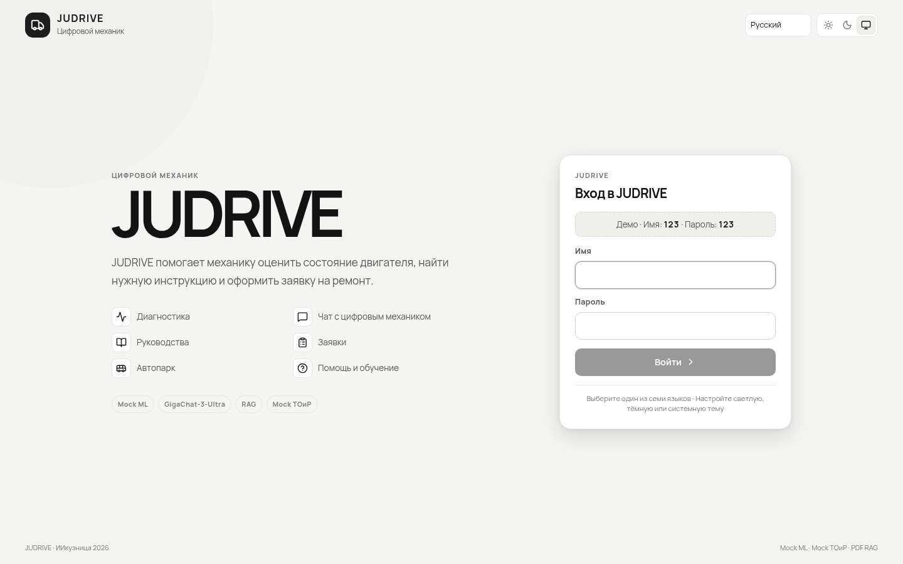
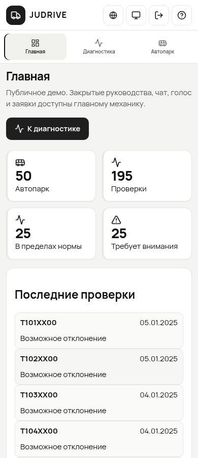
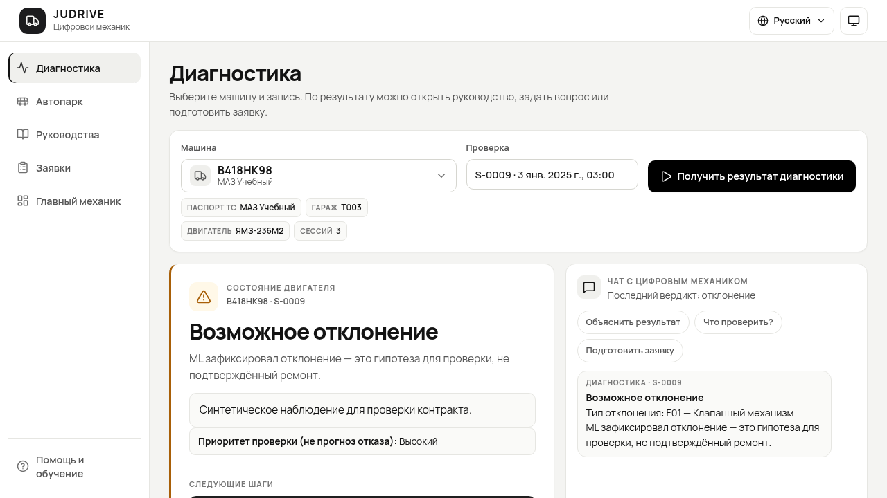
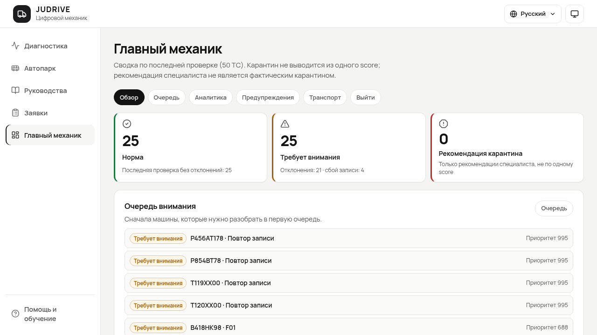
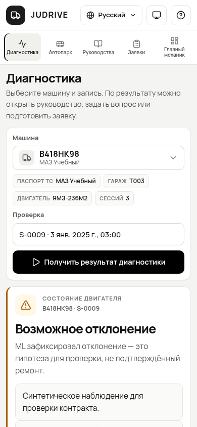
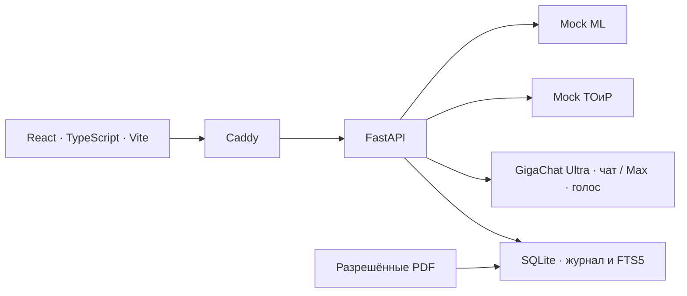

# JUDRIVE · Цифровой механик

JUDRIVE помогает механику разобраться с результатом акустической диагностики двигателя. Приложение связывает проверку с конкретным автомобилем, подбирает применимое руководство и готовит черновик заявки на дефектовку. Главный механик видит состояние парка, динамику проверок и журнал заявок.

## Возможности

- Диагностика по паре «автомобиль / акустическая проверка» и история результатов.
- Поиск по РЭ и РК с цитатами, номерами страниц и просмотром PDF. При расхождении источников приложение показывает обе позиции.
- Чат с GigaChat Ultra, голосовой ввод с редактированием транскрипции и семь языков интерфейса.
- Черновики ТОиР с подтверждением механика и защитой от повторной отправки.
- Дашборд автопарка с фильтрами, динамикой и рекомендациями. Решение о выпуске автомобиля принимает механик.

## Вход и демонстрация

После входа открывается главная страница с последними проверками и быстрыми переходами. Обучение можно пропустить и заново открыть из раздела помощи.

- **Публичное демо** — имя `123`, пароль `123`. Автопарк, история и вызов Mock ML доступны после настройки `DEMO_FLEET_SHA256` для разрешённого к публикации набора. По умолчанию выдача данных автопарка в демо закрыта.
- **Жюри** — полный сценарий по приватной ссылке-приглашению с входом `123/123` (настройки и срок описаны в [API](docs/API.md)). Публичный вход без ссылки не получает закрытые материалы.
- **Главный механик** — отдельные учётные данные из приватного окружения. Эта роль открывает применимые руководства, чат, голос, кабинет и журнал, включая подтверждение тестовой заявки. Для жюри передавайте такую учётную запись приватно и только для согласованного стенда.
- Для полного сценария выберите машину → проверку → диагноз → источники → черновик → подтверждение → номер заявки в журнале. Для локальной приёмки тесты используют изолированный Mock ТОиР. [Сценарии](docs/ACCEPTANCE.md) · [Контракты API](docs/API.md)

## Экраны

Скриншоты сделаны в работающем приложении на синтетических проверках.

| Единый вход · 1440 px | Главная в деморежиме · 390 px |
| --- | --- |
|  |  |

| Диагностика | Кабинет главного механика |
| --- | --- |
|  |  |



## Архитектура



Backend проверяет привязку к двигателю, применимость источника и возможность оформить заявку. Индексация и поиск работают локально. В production наружу выходят только порты Caddy, а данные, сессии и тома SQLite остаются на сервере.

## Структура репозитория

| Каталог | Содержимое |
| --- | --- |
| `frontend/` | Интерфейс механика, PDF-просмотрщик и локализация |
| `backend/app/` | API, агент, RAG, заявки и хранение |
| `vendor/neurodvs_mock/` | Код и схемы предоставленных Mock ML и Mock ТОиР |
| `tests/`, `e2e/` | Автоматические проверки и синтетические данные |
| `deploy/`, `scripts/`, `docs/` | Контейнеры, проверочные команды и руководство |

## Локальная проверка

Нужны Python 3.12, Node.js 22.12+, Chromium для E2E и Docker Compose v2.24.4+ для контейнерной проверки и шрифт DejaVu Sans для синтетических PDF.

```bash
python -m venv .venv
source .venv/bin/activate
python -m pip install -r backend/requirements.txt -r tests/requirements-dev.txt
npm ci
npm ci --prefix frontend
npm run e2e:install

python -m pytest -q
npm --prefix frontend run lint -- --deny-warnings
npm --prefix frontend test
npm --prefix frontend run build
npm run e2e
python scripts/verify_submission_regressions.py --synthetic-pdfs
PYTHON="$PWD/.venv/bin/python" bash scripts/verify_compose.sh
```

Тесты генерируют собственные данные и PDF. Compose открывает тестовый HTTP-порт только на loopback и удаляет контейнеры и временные данные после прогона. При необходимости задайте `E2E_CHROMIUM_EXECUTABLE` для системного Chromium.

## Развёртывание

1. Подготовьте каталог автопарка и разрешённые руководства. Укажите их пути в `JUDRIVE_FLEET_DIR` и `JUDRIVE_MANUALS_DIR`. [Источники и проверка PDF](docs/SOURCES.md)
2. Создайте приватный `.env` по `.env.example`. Задайте домен, каталог SQLite, сессию механика и ключ GigaChat. [Настройка провайдера](docs/GIGACHAT.md)
3. Сверьте DNS, порты и настройки резервного копирования. [Инструкция для VPS](docs/DEPLOY_HTTPS.md)

```bash
docker compose config --quiet
docker compose build backend web
docker compose up -d --no-build
docker compose ps
```

Приложение принимает вход механика после настройки учётных данных. Каталог и выдача PDF требуют роли главного механика. Демо и главному механику выдаются разные подписанные сессии. Готовность проверяется через `/api/ready`, доступность процесса через `/api/live`.

[GitHub Actions](https://github.com/judogaaa/JUDRIVE/actions/workflows/verification.yml) проверяет код и запускает временный стек Compose. Production обновляется вручную по плану отката.

[Пакет сдачи](docs/SUBMISSION.md) · [Сценарии приёмки](docs/ACCEPTANCE.md) · [Финальный отчёт](docs/FINAL_VERIFICATION.md) · [Учёт расходов GigaChat](docs/COST.md)

## Лицензии компонентов

Шрифт Manrope распространяется по SIL Open Font License 1.1. Уведомление входит в дистрибутив приложения. [Лицензия Manrope](frontend/public/fonts/OFL.txt)

[Изолированная LIVE-приёмка на VPS](docs/LIVE_VPS.md)
